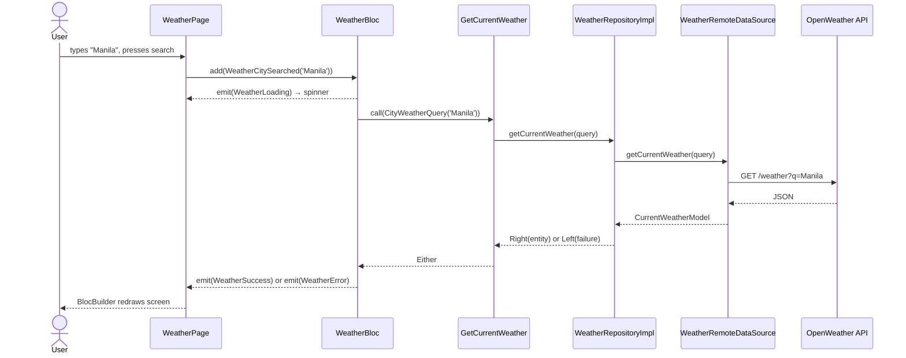
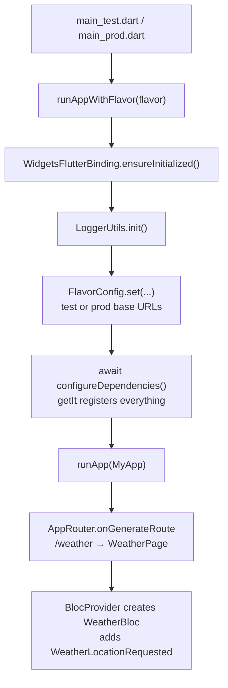
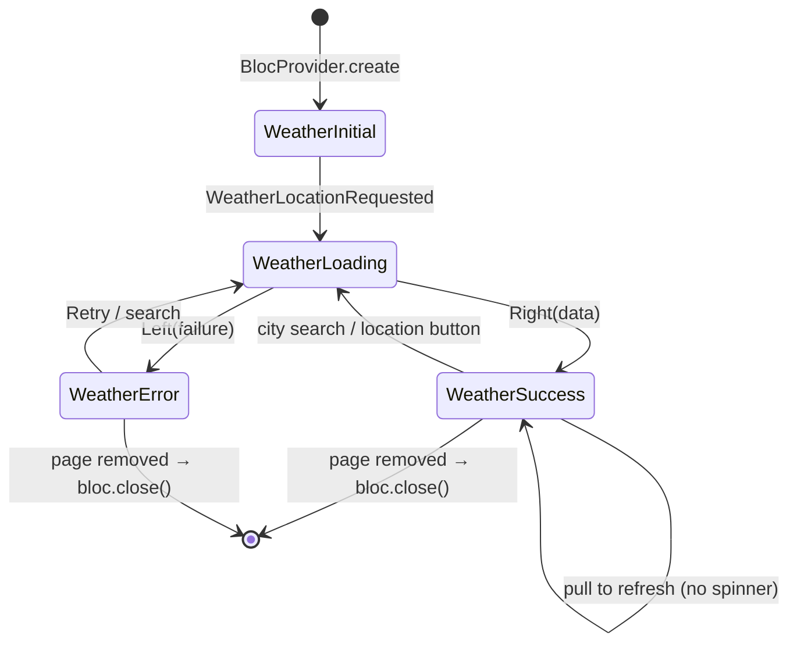
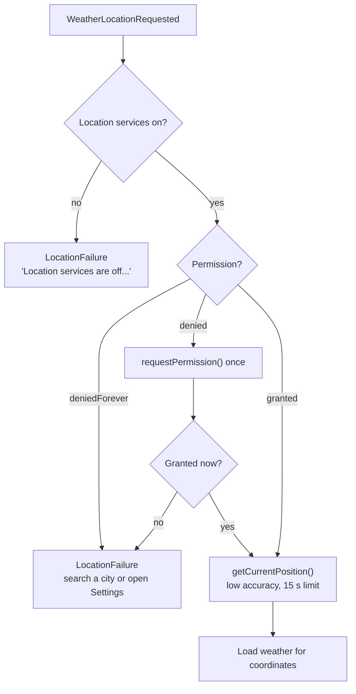

# Weather

A Flutter weather app that shows the current weather and a 5-day forecast for where you are (GPS) or for any city you search. Data comes from [OpenWeather](https://openweathermap.org/api).

It is also a **learning project**. The code follows clean architecture with Bloc, and this README walks you through how it works, one piece at a time, using the weather feature as the example. If you are new to Flutter architecture, read the [Tutorial](#tutorial-how-this-app-works) from top to bottom with the code open next to it.

- [Quick start](#quick-start)
- [Tutorial: how this app works](#tutorial-how-this-app-works)
- [Reference](#reference): commands, flavors, folders, packages, AI setup

---

## Quick start

Requirements:

- Flutter 3.47+ (Dart 3.13+)
- Android: JDK 17 or newer (the JDK bundled with current Android Studio works). Toolchain: Gradle 9.3.1, AGP 9.1.0, Kotlin 2.4.0, Java 17 target.
- iOS: Xcode with iOS 15.0+ deployment target.
- A free OpenWeather API key ([sign up](https://home.openweathermap.org/users/sign_up); a new key can take a couple of hours to start working).

```bash
flutter pub get
dart run build_runner build -d          # generates DI, freezed and JSON code
cp env/example.json env/dev.json        # then put your OpenWeather key in env/dev.json
flutter run --flavor dev -t lib/main_test.dart --dart-define-from-file=env/dev.json   # Android
flutter run -t lib/main_test.dart --dart-define-from-file=env/dev.json                # iOS
```

If you forget `--dart-define-from-file`, the app still starts but shows "OpenWeather API key missing".

On Android, `--flavor` is required. Without it, Gradle builds `app-dev-debug.apk` but Flutter looks for `app-debug.apk` and fails with "Gradle build failed to produce an .apk file". In VS Code, pick a configuration from `.vscode/launch.json` (Run and Debug panel: `dev`, `prod` or `iOS`) instead of the plain Run button.

On an emulator or simulator there is no real GPS. Set a mock location in the emulator settings, or just search for a city.

---

# Tutorial: how this app works

## 1. The big picture: clean architecture

The app is split into **features** (`lib/features/weather/`), and each feature is split into three **layers**:

```
presentation  ──▶  domain  ◀──  data
 what the user     the rules      where the data
 sees and taps     of the app     comes from
```

| Layer | Folder | What lives here | Weather example |
| --- | --- | --- | --- |
| **domain** | `domain/` | Plain Dart classes that describe the app: entities, repository *interfaces*, use cases | `CurrentWeatherEntity`, `WeatherRepository`, `GetCurrentWeather` |
| **data** | `data/` | Code that talks to the outside world: HTTP, GPS, storage. JSON models. Repository *implementations* | `WeatherRemoteDataSource` (Dio), `CurrentWeatherModel`, `WeatherRepositoryImpl` |
| **presentation** | `presentation/` | Bloc, pages, widgets | `WeatherBloc`, `WeatherPage`, `CurrentWeatherCard` |

**The one rule:** arrows point *into* domain. `presentation` and `data` both depend on `domain`, but `domain` depends on nothing (no Flutter, no Dio, no JSON). The page never imports anything from `data/`.

Why bother?

- You can swap OpenWeather for another API by changing only `data/`. The bloc and UI don't change.
- You can test the bloc without a network: give it a fake use case.
- Every file has one job, so you always know where to look.

The full weather feature:

```
lib/features/weather/
  domain/
    entities/        CurrentWeatherEntity, ForecastEntryEntity, DailyForecastEntity,
                     CoordinatesEntity, WeatherQuery
    repositories/    WeatherRepository, LocationRepository        (interfaces)
    usecases/        GetCurrentWeather, GetForecast, GetCurrentLocation
  data/
    models/          CurrentWeatherModel, ForecastResponseModel, ...  (JSON ↔ Dart)
    datasources/     WeatherRemoteDataSource (Dio), LocationDataSource (geolocator)
    repositories/    WeatherRepositoryImpl, LocationRepositoryImpl
  presentation/
    bloc/            WeatherBloc, WeatherEvent, WeatherState
    pages/           WeatherPage
    widgets/         CitySearchField, CurrentWeatherCard, HourlyForecastStrip, ...
```

---

## 2. Follow one request from tap to screen

The best way to learn the architecture is to trace one action. The user types **Manila** and presses search:

| Step | File | What happens |
| --- | --- | --- |
| 1 | `presentation/widgets/city_search_field.dart` | `TextField.onSubmitted` calls the page's callback with `"Manila"`. |
| 2 | `presentation/pages/weather_page.dart` | The page sends an **event** to the bloc: `context.read<WeatherBloc>().add(WeatherCitySearched('Manila'))`. |
| 3 | `presentation/bloc/weather_bloc.dart` | The bloc emits `WeatherLoading` (the UI shows a spinner) and calls the use cases. |
| 4 | `domain/usecases/get_current_weather.dart` | The use case calls the repository interface. |
| 5 | `data/repositories/weather_repository_impl.dart` | The real repository calls the data source and wraps the answer in `Either`. |
| 6 | `data/datasources/weather_remote_data_source.dart` | Dio sends `GET /weather?q=Manila&units=metric&appid=...`. |
| 7 | `data/models/current_weather_model.dart` | The JSON is parsed into `CurrentWeatherModel`, then `toEntity()` turns it into a `CurrentWeatherEntity`. |
| 8 | back in the bloc | The bloc gets `Right(entity)` or `Left(failure)` and emits `WeatherSuccess` or `WeatherError`. |
| 9 | `weather_page.dart` | `BlocBuilder` sees the new state and rebuilds the screen. |

The same trip as a picture:



Keep this table in mind. Every section below zooms in on one of these steps.

---

## 3. Domain layer: entities, repositories, use cases

### Entities

An entity is a plain Dart class with the data the app cares about, in the shape the app wants (not the shape the API sends).

```dart
class CurrentWeatherEntity extends Equatable {
  const CurrentWeatherEntity({required this.cityName, required this.temperature, ...});

  final String cityName;
  final double temperature;
  ...

  @override
  List<Object?> get props => [cityName, temperature, ...];
}
```

`Equatable` makes two entities with the same values count as equal (`==`). Bloc relies on this: if a new state equals the old one, it doesn't rebuild the UI. Tests rely on it too: `expect(result, Right(entity))` only works because of `props`.

`WeatherQuery` shows a useful Dart 3 feature, the **sealed class**. A query is *either* a city *or* coordinates, nothing else:

```dart
sealed class WeatherQuery extends Equatable { const WeatherQuery(); }
final class CityWeatherQuery extends WeatherQuery { final String city; ... }
final class CoordinatesWeatherQuery extends WeatherQuery { final CoordinatesEntity coordinates; ... }
```

Because it's sealed, a `switch` over it must handle both cases, and the compiler tells you if you forget one.

### Repository interface

The domain says *what* it needs, not *how* to get it:

```dart
abstract interface class WeatherRepository {
  Future<Either<Failure, CurrentWeatherEntity>> getCurrentWeather(WeatherQuery query);
  Future<Either<Failure, List<ForecastEntryEntity>>> getForecast(WeatherQuery query);
}
```

`Either<Failure, T>` (from `dartz`) means "either it failed (`Left(Failure)`) or it worked (`Right(value)`)". Errors become normal return values instead of exceptions, so the caller can't forget to handle them.

### Use cases

One class per action. Right now they just forward to the repository, but this is where business rules go when the app grows (for example "never show a forecast older than an hour").

```dart
@lazySingleton
class GetCurrentWeather {
  const GetCurrentWeather(this._repository);
  final WeatherRepository _repository;

  Future<Either<Failure, CurrentWeatherEntity>> call(WeatherQuery query) =>
      _repository.getCurrentWeather(query);
}
```

Because the method is named `call`, you can use the object like a function: `await _getCurrentWeather(query)`.

---

## 4. Data layer: calling the API

### The endpoints

OpenWeather 2.5, base URL `https://api.openweathermap.org/data/2.5`:

| Endpoint | Used for | Query parameters |
| --- | --- | --- |
| `GET /weather` | current weather | `q=Manila` **or** `lat=14.6&lon=121.0`, plus `units=metric`, `appid=<key>` |
| `GET /forecast` | 5 days in 3-hour steps (40 items) | same |

Try one in your browser to see the raw JSON (replace the key):
`https://api.openweathermap.org/data/2.5/weather?q=Manila&units=metric&appid=YOUR_KEY`

### The data source: Dio

`WeatherRemoteDataSourceImpl` is the only class that knows about HTTP:

```dart
final response = await _dio.get<Map<String, dynamic>>(
  '${ApiConstants.openWeatherBaseUrl}/weather',
  queryParameters: _params(query),
);
return CurrentWeatherModel.fromJson(response.data!);
```

`_params` uses a `switch` on the sealed `WeatherQuery` to build either `{'q': city}` or `{'lat': ..., 'lon': ...}`, then adds `units` and `appid`. Dio throws a `DioException` for timeouts, no internet, and HTTP errors like 404.

### Models: JSON → Dart with freezed

The API sends `"feels_like"`, nested objects and sometimes missing fields. Models deal with that mess so entities don't have to:

```dart
@freezed
abstract class WeatherMainModel with _$WeatherMainModel {
  const factory WeatherMainModel({
    required double temp,
    @JsonKey(name: 'feels_like') required double feelsLike,
    @Default(0) int humidity,
  }) = _WeatherMainModel;

  factory WeatherMainModel.fromJson(Map<String, dynamic> json) =>
      _$WeatherMainModelFromJson(json);
}
```

- `@JsonKey(name: ...)` maps the API's snake_case name to a Dart name.
- `@Default(...)` is used when the field is missing.
- The `_$...` code is **generated**. After changing a model, run `dart run build_runner build -d`. Never edit `*.freezed.dart` or `*.g.dart` by hand.

Each top-level model has a `toEntity()` that builds the domain entity. That's the only place JSON shape and app shape meet.

**Time zones:** the API sends `dt` (a UTC timestamp) and `timezone` (the city's offset in seconds). `cityLocalTime(dt, timezone)` adds them so "14:00" means 14:00 *in that city*, not on your phone.

### The repository: exceptions → `Either`

`WeatherRepositoryImpl` calls the data source inside a `try`, and turns every possible exception into a `Failure`:

| What went wrong | Failure | Message the user sees |
| --- | --- | --- |
| HTTP 401 | `UnauthorizedFailure` | "Invalid OpenWeather API key." |
| Key not passed at build time | `UnauthorizedFailure` | "OpenWeather API key missing. Run with --dart-define-from-file=env/dev.json." |
| HTTP 404 | `NotFoundFailure` | "City not found." |
| HTTP 429 / other status | `ServerFailure` | "Too many requests..." / "Weather service error (500)." |
| Timeout | `NetworkFailure` | "The weather service took too long to respond." |
| No connection | `NetworkFailure` | "No internet connection." |
| Anything else (e.g. bad JSON) | `ServerFailure` | "Unexpected error. Please try again." (and logged with `LoggerUtils`) |

After this point no exception ever reaches the bloc. Failures live in `lib/core/error/failure.dart` so other features can reuse them.

### The API key

The key is **not** in the code. `ApiConstants` reads it at compile time:

```dart
static const String openWeatherApiKey = String.fromEnvironment('OPENWEATHER_API_KEY');
```

The value comes from `env/dev.json` (gitignored) through `--dart-define-from-file=env/dev.json`. `env/example.json` is committed so people know the format. Why: [decision 0002](docs/decisions/0002-openweather-api-key.md). Note that the key still ends up inside the built app, so a paid key should go behind a backend instead.

---

## 5. Dependency injection: who creates what

Nobody in the app writes `WeatherRepositoryImpl(WeatherRemoteDataSourceImpl(Dio()))` by hand. Instead, classes are **annotated** and `injectable` generates the wiring:

| Annotation | Meaning | Used on |
| --- | --- | --- |
| `@LazySingleton(as: WeatherRepository)` | one shared instance, registered under the interface type | repositories, data sources |
| `@lazySingleton` | one shared instance | use cases |
| `@injectable` | a **new** instance every time | `WeatherBloc` (each page gets a fresh bloc) |
| `@module` + getters | for classes you don't own | `Dio`, `FlutterSecureStorage`, `GeolocatorPlatform` in `lib/core/di/core_module.dart` |

Run `dart run build_runner build -d` and it writes `lib/core/di/injection.config.dart`. Then anywhere in the UI, `getIt<WeatherBloc>()` returns a bloc with all its use cases, repositories, data sources and Dio already plugged in.

The constructor is the list of dependencies: `WeatherBloc(this._getCurrentWeather, this._getForecast, this._getLocation)`. In tests you pass mocks into that same constructor, without `getIt`.

---

## 6. Bloc: events in, states out

A bloc is a box: **events** go in, **states** come out, and the UI draws whatever the latest state is.

```
 UI ──add(event)──▶ WeatherBloc ──emit(state)──▶ UI rebuilds
```

### Events (`weather_event.dart`): what the user did

| Event | Sent when |
| --- | --- |
| `WeatherLocationRequested` | the page opens, or the user taps the location button |
| `WeatherCitySearched(city)` | the user submits the search field |
| `WeatherRefreshed` | pull to refresh, or the Retry button |

### States (`weather_state.dart`): what the UI should show

| State | UI |
| --- | --- |
| `WeatherInitial`, `WeatherLoading` | spinner |
| `WeatherSuccess(current, hourly, daily)` | the weather card, next 24 hours, 5-day list |
| `WeatherError(message, canRetry)` | message + Retry button (hidden when retrying can't help, like "City not found") |

Events and states are `sealed` + `Equatable`, like the entities.

### Handlers: turning an event into states

```dart
on<WeatherCitySearched>(_onCitySearched);

Future<void> _onCitySearched(WeatherCitySearched event, Emitter<WeatherState> emit) async {
  final city = event.city.trim();
  if (city.isEmpty) return;              // ignore blank searches
  ...
  emit(const WeatherLoading());          // 1. show spinner
  await _load(id, query, emit);          // 2. fetch, then emit Success or Error
}
```

Inside `_load`, the bloc runs both requests **at the same time** with a record's `.wait`, then combines the two `Either`s:

```dart
final (current, forecast) = await (_getCurrentWeather(query), _getForecast(query)).wait;
```

`flatMap` / `map` on `Either` build a `WeatherSuccess` only if *both* succeeded; otherwise the first failure becomes a `WeatherError`.

### Two real-world problems the bloc solves

1. **Stale results.** GPS can take 15 seconds. If the user searches "Tokyo" meanwhile, the slow GPS answer must not overwrite Tokyo. Every request gets a number (`_requestId`); when an answer comes back, the bloc checks it's still the newest request before emitting.
2. **Pull to refresh that never stops.** `RefreshIndicator` spins until a `Future` completes. If the refreshed data is identical, Bloc emits nothing (equal states are skipped), so "wait for the next state" would wait forever. Instead, `WeatherRefreshed` carries a `Completer` that the bloc completes when it's done, whatever happened.

### Connecting the bloc to the UI

```dart
// WeatherPage: create the bloc and start loading
BlocProvider(
  create: (_) => getIt<WeatherBloc>()..add(const WeatherLocationRequested()),
  child: const WeatherView(),
);

// WeatherView: draw the current state
BlocBuilder<WeatherBloc, WeatherState>(
  builder: (context, state) => switch (state) {
    WeatherInitial() || WeatherLoading() => const Center(child: CircularProgressIndicator()),
    WeatherError(:final message, :final canRetry) => _ErrorView(message: message, canRetry: canRetry),
    WeatherSuccess() => _WeatherContent(state: state),
  },
);

// Anywhere below: send an event
context.read<WeatherBloc>().add(WeatherCitySearched(city));
```

- `BlocProvider` creates the bloc and makes it available to every widget below it.
- `BlocBuilder` rebuilds when the state changes. The `switch` must cover every state because `WeatherState` is sealed.
- `context.read` gets the bloc once (for sending events). Use it in callbacks, not in `build`.

The page is split into `WeatherPage` (creates the bloc) and `WeatherView` (draws it) so a test can give `WeatherView` a fake bloc.

---

## 7. Lifecycle: what happens, in order

### App startup



| # | Code | What it does |
| --- | --- | --- |
| 1 | `lib/main_test.dart` → `runAppWithFlavor('test')` | Entry point. There's one per flavor (`main_prod.dart` passes `'prod'`). |
| 2 | `WidgetsFlutterBinding.ensureInitialized()` | Lets you use plugins before `runApp`. |
| 3 | `LoggerUtils.init()` | Sets up logging. Use `LoggerUtils`, never `print`. |
| 4 | `FlavorConfig.set(...)` | Picks base URLs for test or prod. |
| 5 | `await configureDependencies()` | Registers everything in `getIt` (section 5). |
| 6 | `runApp(const MyApp())` | `MaterialApp` with `initialRoute: RouteNames.weather`. `onGenerateInitialRoutes` builds only that route, so there is no hidden page underneath (and no back button). |
| 7 | `AppRouter.onGenerateRoute` | Maps `/weather` to `WeatherPage`. |

### Page and bloc lifecycle



1. `WeatherPage` is built → `BlocProvider.create` runs once → new `WeatherBloc` → `WeatherLocationRequested` is added.
2. The bloc asks for location permission (first time only), gets coordinates, loads weather.
3. The user searches, refreshes, retries: more events, more states.
4. The page is removed (navigating away) → `BlocProvider` calls `bloc.close()` for you. You never close a bloc you got from `BlocProvider(create: ...)` yourself.

### Widget lifecycle

`CitySearchField` is a `StatefulWidget` because it owns a `TextEditingController`. Anything you create in a `State`, you clean up in `dispose()`:

```dart
final _controller = TextEditingController();

@override
void dispose() {
  _controller.dispose();
  super.dispose();
}
```

Stateless widgets (`CurrentWeatherCard`, `DailyForecastList`, ...) just take data in their constructor and draw it.

### Location permission lifecycle

`LocationDataSourceImpl` goes through the steps every location app needs:




1. Location services off? → `LocationFailure("Location services are off...")`.
2. Permission `denied`? → ask once with `requestPermission()`.
3. Still denied, or `deniedForever`? → `LocationFailure` telling the user to search or open Settings.
4. Otherwise → `getCurrentPosition` (low accuracy is enough for weather; 15-second time limit).

Platform setup that makes this work: `ACCESS_COARSE_LOCATION`, `ACCESS_FINE_LOCATION` and `INTERNET` in `android/app/src/main/AndroidManifest.xml`, and `NSLocationWhenInUseUsageDescription` in `ios/Runner/Info.plist`.

---

## 8. Testing

`test/` mirrors `lib/`. Mocks use `mocktail`. Unit tests never call the real API or `getIt`.

- **Repository tests:** a mock data source throws a `DioException` with status 404 → expect `NotFoundFailure`.
- **Bloc tests:** mock use cases, add an event, check the states:

```dart
final expectation = expectLater(
  bloc.stream,
  emitsInOrder([const WeatherLoading(), WeatherSuccess(...)]),
);
bloc.add(const WeatherCitySearched('Manila'));
await expectation;
```

(`bloc_test` isn't used: it conflicts with `freezed` 4.)

```bash
flutter test
```

---

## 9. Try it yourself

Small exercises, easiest first. Each one touches a different layer.

1. **UI only:** show the wind direction. Add `deg` to `WindModel`, a field to `CurrentWeatherEntity`, map it in `toEntity()`, show it in `CurrentWeatherCard`. Run build_runner.
2. **Bloc:** after a failed pull to refresh, keep the old results on screen and show a `SnackBar` instead of the error view. (Hint: `BlocListener`.)
3. **New use case:** remember the last searched city with `flutter_secure_storage` and load it when location is denied.
4. **New feature:** run `/new-feature air_quality air_pollution` in Claude Code and build an air-quality screen from OpenWeather's `/air_pollution` endpoint.

Before calling any change done: `dart run build_runner build -d`, `flutter analyze` and `flutter test` must all pass.

---

# Reference

## Commands

```bash
flutter pub get
dart run build_runner build -d   # regenerate DI, freezed and json code
dart run build_runner watch -d   # regenerate on save
flutter analyze
flutter test
flutter run --flavor dev -t lib/main_test.dart --dart-define-from-file=env/dev.json    # Android, test backend
flutter run --flavor prod -t lib/main_prod.dart --dart-define-from-file=env/dev.json   # Android, prod backend
flutter run -t lib/main_test.dart --dart-define-from-file=env/dev.json                 # iOS
flutter build apk --flavor dev -t lib/main_test.dart --dart-define-from-file=env/dev.json
```

---

## Flavors

| Flavor | Entry point | Android | iOS | Backend |
| --- | --- | --- | --- | --- |
| test | `lib/main_test.dart` (also `lib/main.dart`) | `--flavor dev` | no flavor (`-t lib/main_test.dart`) | test URL |
| prod | `lib/main_prod.dart` | `--flavor prod` | no flavor (`-t lib/main_prod.dart`) | prod URL |

Base URLs live in `lib/core/constants/network/api_constants.dart`. OpenWeather uses the same URL in both flavors. Android product flavors are defined in `android/app/build.gradle.kts`; iOS has no flavor schemes yet, so pass only `-t` on iOS.

---

## Project structure

```
lib/
  app.dart                     runAppWithFlavor(), MyApp
  main.dart, main_test.dart, main_prod.dart
  core/
    constants/network/         ApiConstants (base URLs, API key), FlavorConfig
    constants/routes/          RouteNames, AppRouter
    di/                        get_it + injectable setup (injection.config.dart is generated)
    error/                     Failure subclasses, data-layer exceptions
    model/                     shared entities/models
    utils/                     LoggerUtils, loading dialog
  features/
    weather/                   current weather + forecast (OpenWeather, geolocator)
    splash/                    placeholder splash screen (not the start route yet)
test/                          mirrors lib/
env/                           build-time config (example.json committed, dev.json gitignored)
docs/                          architecture, decisions, feature specs (Obsidian vault)
```

More detail: [docs/architecture.md](docs/architecture.md), [weather spec](docs/features/weather.md).

---

## Stack

| Concern | Package |
| --- | --- |
| State management | `flutter_bloc` 9, `equatable` 3 |
| Dependency injection | `get_it` 9, `injectable` 3 (+ `injectable_generator`) |
| Networking | `dio` 5, `pretty_dio_logger` |
| Models | `freezed` 4 / `freezed_annotation` 3, `json_serializable` |
| Errors | `dartz` (`Either<Failure, T>`) |
| Location | `geolocator` 14 |
| Storage | `flutter_secure_storage` 11 |
| QR scanning | `mobile_scanner` 7 |
| UI helpers | `google_fonts`, `flutter_screenutil`, `flutter_spinkit` |
| Logging | `logger` 2 via `LoggerUtils` |
| Testing | `flutter_test`, `mocktail` |

---

## Starting a new app from this template

1. Rename the package: change `name:` in `pubspec.yaml` and replace `package:try_ko_ulit_clean_arch/` in `lib/` and `test/`.
2. Android: update `namespace` and `applicationId` in `android/app/build.gradle.kts`, and move `MainActivity.kt` to the matching package folder.
3. iOS: update `PRODUCT_BUNDLE_IDENTIFIER` in Xcode (Runner target).
4. Set real base URLs in `ApiConstants`.

---

## Docs (and Obsidian)

`docs/` holds the project's notes: architecture, decision records and one spec per feature, plus templates for new notes. It is plain Markdown; optionally open the `docs/` folder in [Obsidian](https://obsidian.md) as a vault. See [docs/README.md](docs/README.md).

---

## AI setup (Claude Code)

| File | What it does |
| --- | --- |
| `CLAUDE.md` | Project rules Claude reads every session: stack, layout, conventions, commands, docs and README rules. |
| `.mcp.json` | Dart & Flutter MCP server (`dart mcp-server`): live analyzer errors, tests, hot reload, pub.dev search. Approve it once when Claude Code asks. |
| `.claude/settings.json` | Pre-approved safe commands (analyze, test, format, build_runner), plus hooks. |
| `.claude/hooks/format-dart.sh` | Runs `dart format` on every Dart file Claude writes or edits. |
| `.claude/hooks/readme-check.sh` | When Claude finishes and code changed but `README.md` did not, asks it once to update the README or say why not. |
| `.claude/skills/new-feature/` | `/new-feature <name> [endpoint]`: scaffolds a full feature (all layers, Bloc, DI, tests, spec note) and verifies it builds. |
| `.claude/agents/planner.md` | Read-only agent that turns a request into a feature spec and step-by-step plan. |
| `.claude/agents/test-writer.md` | Writes and runs repository, use case and bloc tests. |
| `.claude/agents/arch-reviewer.md` | Read-only review of changes against the clean-architecture rules. |

Typical flow: describe the feature, let `planner` draft `docs/features/<feature>.md`, run `/new-feature <feature>`, then ask for `test-writer` and `arch-reviewer`.

Hooks and agents load when a Claude Code session starts; after pulling changes to `.claude/`, restart the session or open `/hooks` once.
